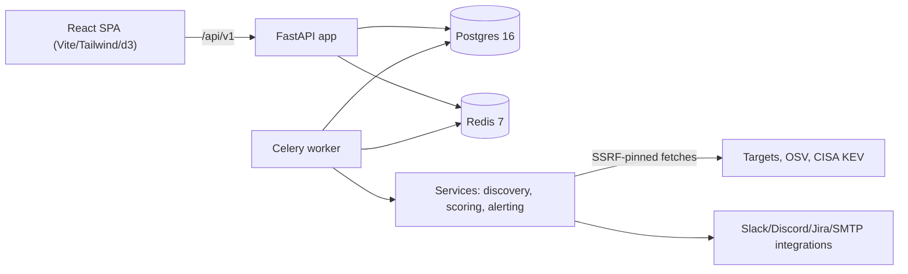

# SentinelASM Architecture

Companion to the [threat model](threat-model.md), the
[operations runbook](OPERATIONS.md), the [RLS design](rls-design.md) and the
generated [API reference](API.md). Code pointers are given for each flow so
a new maintainer can trace any path from route to task.

## Stack at a glance



Single-host compose maps this onto: nginx (unprivileged, 8080/8443) →
backend (non-root, read-only rootfs) → Postgres/Redis (no host ports);
worker + beat use the backend image with Celery entrypoints
(`docker-compose.yml`); Prometheus metrics live behind a token gate.

---

## 1. Authentication flow

```
register → user (bcrypt hash) + organization; returns TokenBundle
login    → verify password (constant-time bcrypt compare) → access (15 min) +
           refresh (7 d, rotating family); lockout counters engaged on failure
refresh  → old refresh blacklisted (Redis), new one issued within the family;
           reuse of a rotated token burns the whole family (theft detection)
logout   → refresh blacklisted; access dies with its 15-min TTL
```

- Code: `backend/app/api/v1/auth.py`, token lifecycle in
  `backend/auth/token_store.py`, rotation semantics + family burn are
  characterised by `backend/tests/v3/test_token_family*.py`.
- Login lockout is a **separate layer** from rate limiting: per-account plus
  per-IP exponential backoff (base 60 s, cap 15 min, 5 fails / 300 s window)
  in `backend/auth/lockout.py`; counters live in Redis. Whenever the
  counter store is unreachable, login returns the uniform 503 envelope
  (`auth_unavailable`) rather than opening a bypass. Admin unlock:
  `scripts/unlock_account.py`.
- Password change: requires the current password, revokes sibling sessions
  while stretching the caller's own access token, and stores the hash of the
  new passphrase (renewing with the same one fails validation
  `password_reuse`).
- Roles: viewer / analyst / admin, 10 discrete permissions checked per
  route (`backend/app/core/permissions.py`).
- Everything a privileged actor did lands in `audit_logs` (spoofed
  X-Forwarded-For never overrides the recorded peer —
  `TRUSTED_PROXIES`).

## 2. Two-factor (TOTP) flow

```
enroll → restricted 'enroll_2fa' token (single route) → returns TOTP secret +
         10 recovery codes (SHA-256-hashed, 16× base32 chars each)
setup  → 'MfaStep' enforces the exact TOTP code claim INVARIANT (each code
         value verifies at most once per device inside ±1 window): the
         step state is claimed atomically in Redis ('totp.claim_totp_step')
login  → password verified first → 'mfa_required' response → TOTP or recovery
         code (locked out identically on repeated failures)
```

- Code: `backend/auth/totp.py` (pyotp 2.10; constant-time compare),
  `/api/v1/auth/2fa/*` endpoints, frontend `MfaStep.tsx` +
  `RecoveryCodesDisplay.tsx` (jsdom+RTL-tested).
- Reset (lost device): operator runs `scripts/reset_2fa.py` against a
  scratch/demo DB (`db_guard.sh` refuses to point it at `sentinelasm`).

## 3. Scan flow

```
POST /scans (domain must be verified)
    → DomainVerification gate: verified + unexpired + in-grace else 403
      ('domain_not_verified'); RATE_LIMIT_SCAN_REQUESTS_PER_MINUTE applies
    → `celery.send("tasks.discovery.run_discovery", scan_id)` to queue 'scans'
        for each sub sole subdomain (phases):
            DNS resolve → subdomain enumeration (crt.sh-free fixture only in tests)
            port scan + service fingerprints → SSL certificate introspection
            WHOIS/dns sparkle → findings synthesis
        (worker streams intermediate rows so scans/{id} shows progress)
    → findings scoring: KEV catalog hit, OSV reference, age, exposure
        (backend/services/scoring/risk_engine.py; KEV cached on disk)
    → frontends display findings/chart/graph; reports can be exported
```

Failure handling: the worker config sets per-task soft/hard time limits
(10/11 min), `acks_late`, `reject_on_worker_lost`, and any repeat offroader
gets moved to the `dlq` queue (`tasks/jobs.py::move_to_dlq`) — see
`backend/workers/celery_app.py` for the topology. Network-touching fetches go
through the SSRF-pinned `fetch_url_validated_sync` (DNS rebinding guard +
HTTPS pinning); enrichment services stay out of the request path.

## 4. Ownership verification flow

```
POST /scans/verify-ownership        → register challenge token (random 32 B)
        → store token in DB + respond with TXT instructions
        domain TXT:<token>
GET /scans/verify-ownership/check   → resolves TXT via resolver for the DB row
        and flips state accordingly ('verified' / 'pending' / 'failed')
expiry (90 d) + 14 d grace window; daily recheck via Cyan (
'tasks.verification.recheck_verified_domains' + scheduler)
```

Code pointers: `backend/app/api/v1/scans.py`,
`backend/services/ownership/verification.py`, fixtures + scheduling in
`backend/tasks/verification_tasks.py`. `REQUIRE_DOMAIN_VERIFICATION=False`
exists for local dev only.

## 5. Alerting + digest flow

```
add integration (webhook optional secret Fernet-encrypted)
    → test-dispatch button can be used to fire a representative payload
digest config (webhook digest = daily / weekly pick + channel)
    → beat tick wakes it:
        'tasks.scheduler.send_due_email_digests' (hourly)
    → findings scaled to render digest content and fire out
```

- Integrations: `backend/app/api/v1/alerting.py` +
  `backend/services/alerting/dispatch.py`; outbound ports restricted by
  `WEBHOOK_ALLOWED_PORTS`; Fernet-encrypted secrets decrypted with the
  active key from `SECRETS_ENCRYPTION_KEY`.
- Digest scheduling: `backend/tasks/scheduler_tasks.py` (beat entries in
  `backend/workers/celery_app.py`); delivery failure attempts reconnect or
  record error-state rows for retries; SMTP config documented in
  `docs/OPERATIONS.md` § SMTP.

## 6. Data model in two sentences

Tables (`backend/models/`) split into tenant-scoped roots (`domains`,
`assets`, `findings`, `scans`, …, each carrying `organization_id`) and child
rows reached through the owning asset; cross-tenant read isolation is
enforced at every repository and is characterised by
`backend/tests/v3/test_tenant_matrix.py`. See `docs/rls-design.md` for where
database-level RLS could replace the repository-level guarantee (deferred —
the reasoning lives there).

## 7. Observability

- `/metrics` gated by `METRICS_BEARER_TOKEN` or `METRICS_ALLOWED_CIDRS`
  (per-route counters at `backend/metrics/`; nginx 404s the path at the
  edge).
- Structured logging (`LOG_FORMAT=json` for ingestion; `LOG_LEVEL` standard
  Python).
- Compose healthchecks for every app service except beat (rationale in
  README §Monitoring).
