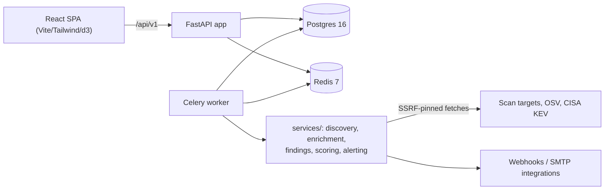

# SentinelASM Architecture

Companion to the [threat model](threat-model.md), the
[operations runbook](OPERATIONS.md), the [RLS design](rls-design.md) and the
generated [API reference](API.md). Code pointers are given for each flow so
a new maintainer can trace any path from route to task.

## Stack at a glance



Single-host compose maps this onto: nginx (unprivileged, 8080/8443 host-mapped) →
backend (non-root UID 10001, read-only rootfs) → Postgres/Redis (no host
ports); worker + beat reuse the backend image with Celery entrypoints
(`docker-compose.yml`). Prometheus metrics live behind a token/CIDR gate.

---

## 1. Authentication flow

```
register → user (bcrypt hash) + organization; returns TokenBundle
login    → constant-time bcrypt verify → access (15 min) + refresh (7 d,
           rotating family); lockout counters engage on failure
refresh  → previous refresh blacklisted in Redis, new one issued inside the
           family; reuse of an already-rotated token burns the whole family
           (theft detection)
logout   → refresh blacklisted; access dies with its remaining TTL
```

- Code: `backend/app/api/v1/auth.py`; token lifecycle in
  `backend/auth/token_store.py`; rotation + family-burn semantics are
  characterised by the v3 token tests in `backend/tests/v3/`.
- Password change requires the current password, revokes sibling sessions,
  and `password_reuse` rejects re-setting the same passphrase. API keys are
  exempt from 2FA by design and rejected as a credential for the
  change-password route.
- Login lockout is a separate layer from rate limiting: per-account **and**
  per-IP exponential backoff (5 fails / 300 s window, base 60 s, cap 15 min)
  in `backend/auth/lockout.py`, counters in Redis. If the counter store is
  unreachable, login returns the uniform 503 `auth_unavailable` envelope —
  never a per-user signal. Admin unlock: `scripts/unlock_account.py`.
- Roles: viewer / analyst / admin — 10 discrete permissions checked per
  route (`permissions` module). Every privileged action lands in
  `audit_logs`; spoofed `X-Forwarded-For` never overrides the recorded peer
  (see `TRUSTED_PROXIES`).

## 2. Two-factor (TOTP) flow

```
enroll   → restricted 'enroll_2fa' token route → TOTP secret + 10 recovery
           codes (single shown once, stored SHA-256-hashed)
verify   → first TOTP code flips the account to 2fa_enabled; each TOTP or
           recovery code value may be consumed at most once (atomic Redis
           claim — totp.claim_totp_step — inside the ±1 window)
login    → password verified → 'mfa_required' → TOTP/recovery code; failures
           feed the same lockout counters as password guesses
```

- Code: `backend/auth/totp.py` (pyotp, constant-time compare),
  `/api/v1/auth/2fa/*` endpoints, frontend `MfaStep.tsx` +
  `RecoveryCodesDisplay.tsx` (jsdom+RTL-tested).
- Lost device: operator runs `scripts/reset_2fa.py` against a scratch/demo
  DB (`scripts/db_guard.sh` refuses to point it at the dev database).

## 3. Scan flow

```
POST /scans  (target domain must be verified)
  → verification gate: verified + unexpired (+ within grace) else
    403 domain_not_verified; limited by RATE_LIMIT_SCAN_REQUESTS_PER_MINUTE
  → Celery worker picks up 'tasks.discovery.run_discovery' (queue 'scans')
      phase 1  DNS resolution / subdomain enumeration      → rows recorded
      phase 2  port scanning + service banners               → rows recorded
      phase 3  SSL/TLS certificate introspection             → rows recorded
      phase 4  enrichment (OSV/KEV) + findings synthesis     → findings rows
      phase 5  external alert dispatch for new findings      → webhooks/SMTP
  → GET /scans/{id}/findings + /findings show progress as rows appear
```

Failure handling: candidate hostnames from `scan target lists` are resolved
only after SSRF pinning (`fetch_url_validated_sync`) — a hostname may not
route to the machine's own/loopback/link-local address or fixed metadata
endpoints. Time limits are 10 min soft / 11 min hard, `acks_late` +
`reject_on_worker_lost` re-queues crashed tasks, and permanently failed
tasks are moved to the `dlq` queue (`move_to_dlq`). The KEV catalog is
cached to disk (`kev_cache_dir`; named volume in compose) so worker ticks
don't hammer CISA.

## 4. Ownership verification flow

```
POST /scans/verify-ownership  → server stores a random challenge token and
  answers with the exact TXT record string to publish
GET  /scans/verify-ownership/check → resolves the TXT record and flips the
  domain into 'verified' (expiry 90 days by default) or reports 'pending'
daily recheck of all verified domains (Celery beat) catches lapsed
  TXT records; a 14-day grace period applies to grandfathered domains
```

Code pointers: `backend/app/api/v1/scans.py`,
`backend/services/verification/`, `backend/tasks/verification_tasks.py`.
`REQUIRE_DOMAIN_VERIFICATION=False` exists for local dev only.

## 5. Alerting + digest flow

```
integration (Slack/Discord/Jira webhook; credential optional)
  → stored Fernet-encrypted; a 'send test' endpoint fires a representative
    payload so operators can confirm delivery before relying on it
new finding  → task dispatch resolved per integration
digest config (frequency + recipients)
  → hourly beat tick collects findings newer than the last digest email
    and sends one summary
```

- Integrations: `backend/app/api/v1/alerting.py` + `backend/services/alerts/`
  (dispatch helpers); outbound ports restricted by
  `WEBHOOK_ALLOWED_PORTS` (default `443,8443`).
- Digests: `backend/tasks/scheduler_tasks.py` (beat entries registered in
  `backend/workers/celery_app.py`); delivery failures are logged and
  retried on the next tick rather than dropped. SMTP settings are in
  `README.md`'s configuration table; a missing SMTP config makes digest
  sends fail visibly instead of silently skipping.
- Losing `SECRETS_ENCRYPTION_KEY` makes every encrypted credential
  unrecoverable — sends fail closed with a "check SECRETS_ENCRYPTION_KEY"
  error (rotation runbook: `docs/OPERATIONS.md` § key rotation).

## 6. Data model in two sentences

Tables (`backend/models/`) split into tenant-scoped roots (each carrying
`organization_id`: `domains`, `assets`, `findings`, `scan_history`,
`scan_policies`, `alerting`…) and child rows reached through the owning
asset; cross-tenant isolation is enforced at the repository layer and is
characterised by `backend/tests/v3/test_tenant_matrix.py`. See
`docs/rls-design.md` for where database-level RLS could replace the
repository-level guarantee (deferred — the reasoning lives there).

## 7. Observability

- `/metrics` gated by `METRICS_BEARER_TOKEN` or `METRICS_ALLOWED_CIDRS`
  (per-route counters from `backend/metrics/`; nginx 404s the path at the
  edge).
- Structured logging (`LOG_FORMAT=json` for ingestion; `LOG_LEVEL` standard
  Python levels).
- Compose healthchecks for every app service except beat (rationale in
  README §Monitoring).
